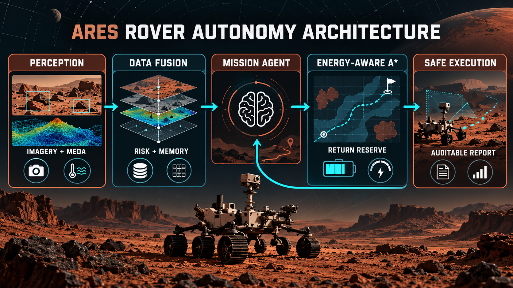

# Ares Rover

### Data-informed, risk-aware autonomous mission planning for Mars exploration

[](https://github.com/haarikaalla/Agentic-AI-Mars-Rover/actions/workflows/ci.yml)


Ares Rover is an explainable autonomy platform that combines Mars imagery metadata, MEDA environmental telemetry, perception-risk fusion, bounded mission memory, energy-aware A* planning, explicit return reserves, and auditable mission reports.

The system is designed around one operational principle: **science collection is valuable only when the rover can still return safely.** Learned or uncertain perception is therefore separated from the deterministic safety planner. A fused risk assessment can allow execution, require caution, or stop the rover before route execution begins.



## Verified project outcomes

The figures below are generated by repository code and committed as machine-readable reports. They are not invented portfolio claims.

| Result | Verified value | Evidence |
| --- | ---: | --- |
| Committed dataset rows profiled | **128,446** | [`docs/dataset-evidence.json`](docs/dataset-evidence.json) |
| Rows parsed successfully | **100%** | Dataset profiler output |
| Key image-metadata coverage | **100%** of 856 records | ID, sol, camera, date, rover, and status |
| Core MEDA navigation-field coverage | **100%** of 119,321 records | Position, orientation, velocity, time, and solar context |
| Local-temperature coverage | **100%** of 8,269 records | 195.08–261.70 K, mean 210.69 K |
| Safe return across benchmark matrix | **100%** — 6 of 6 scenarios | [`docs/mission-benchmark.json`](docs/mission-benchmark.json) |
| Energy-reserve compliance | **100%** — 6 of 6 scenarios | 5-unit reserve across budgets 15–50 |
| Full science completion | **66.67%** — 4 of 6 scenarios | Lower budgets return early instead of violating safety |

The 100% safe-return result is a **deterministic simulator benchmark**, not a claim of flight readiness. It shows the intended safety behavior: with budgets of 15 and 20 the rover collects one sample and returns early; with budgets of 25, 30, 40, and 50 it collects both samples and returns to base.

## Why this is useful for Mars-rover autonomy

Planetary missions operate with limited energy, incomplete sensor channels, difficult terrain, and long communication delays. A useful autonomy system must make local decisions while remaining conservative and explainable.

Ares provides a compact reference architecture for that problem:

- **Perception uncertainty is explicit.** Obstacle probability, temperature, pitch, and roll become a scored risk assessment.
- **Missing telemetry increases caution.** Unknown temperature or tilt is treated as uncertainty, not silently replaced with a safe value.
- **Risk decisions are auditable.** Every assessment includes a score, level, action, reasons, and original frame.
- **Mission memory is bounded.** Recent decisions remain available without unbounded state growth.
- **Planning optimizes energy.** Weighted A* can prefer a longer route when it consumes less power.
- **Safety is a hard invariant.** The agent checks outbound cost, return cost, and reserve before visiting a science target.
- **Low energy causes safe degradation.** The rover returns early instead of forcing mission completion.
- **Evidence is reproducible.** Dataset and mission percentages are generated by versioned command-line tools.

## System architecture

The maintained implementation is split into six layers:

| Layer | Component | Responsibility |
| --- | --- | --- |
| Evidence | `rover.evidence` | Stream and validate committed imagery and MEDA CSVs |
| Perception fusion | `DataFusionAgent` | Combine obstacle confidence, temperature, pitch, and roll |
| Risk memory | `RiskAssessment` history | Preserve recent scored actions and reasons |
| Mission control | `AutonomousMissionController` | Gate route execution using the fused safety decision |
| Planning | `a_star` + `AutonomousRover` | Select targets, minimize energy, preserve return reserve |
| Verification | benchmark + pytest + CI | Measure behavior across budgets and prevent regressions |

### Agent decision loop

1. Receive a `PerceptionFrame` from camera and environmental pipelines.
2. Validate the frame and calculate an explainable risk score.
3. Store the assessment in bounded memory.
4. Stop and replan when risk is high; otherwise hand control to mission planning.
5. Calculate energy-aware paths to each remaining science target.
6. Include the route back to base and the configured reserve in every feasibility check.
7. Collect the safest feasible target, update energy, and replan.
8. Return to base and emit a structured mission report.

## Advanced technology stack

### Autonomy and data engineering

- **Python 3.11+** with complete type annotations
- **Agentic mission controller** with perception gating and bounded memory
- **Weighted A\*** graph search with an admissible Manhattan heuristic
- **Streaming CSV profiling** that handles large telemetry files without loading them fully into memory
- **Dataclasses and immutable reports** for predictable state and serialization
- **Configurable risk policy** for temperature, tilt, caution, and hold thresholds
- **Deterministic benchmarking** across multiple energy budgets

### Engineering and delivery

- **Hatchling** package build system
- **pytest** regression suite
- **Ruff** linting and modernization checks
- **mypy** static type analysis
- **GitHub Actions** CI for every push and pull request
- **JSON evidence artifacts** suitable for review or downstream dashboards
- **Zero runtime dependencies** beyond the Python standard library

## Dataset evidence

### Curiosity image catalogue

`mars_rover_dataset.csv` contains 856 image-metadata records from Curiosity sol 1000 across five camera systems:

| Camera | Records | Operational role |
| --- | ---: | --- |
| MAST | 838 | Long-range terrain and science context |
| NAVCAM | 10 | Navigation context |
| CHEMCAM | 4 | Remote composition investigation |
| FHAZ | 2 | Front hazard awareness |
| RHAZ | 2 | Rear hazard awareness |

All 856 records contain the six key metadata fields checked by the profiler. The CSV references image paths; the profile measures catalogue integrity and camera coverage, not image-classification accuracy.

### MEDA navigation telemetry

`meda dataset.csv` contributes 119,321 records with complete time, solar, position, velocity, pitch, yaw, and roll fields. The profiler correctly identifies that all observations are stationary at one position. This makes the extract useful for validating telemetry ingestion and stable-orientation context, but not for claiming driving-distance or trajectory performance.

Observed orientation envelope:

- pitch: 0.06°–0.16°, mean 0.0991°;
- roll: 0.15°–0.20°, mean 0.1653°;
- stationary observations: 100%.

### Environmental telemetry

The sol-17 weather extract contains 8,269 valid local-temperature values:

- minimum: 195.08 K;
- maximum: 261.70 K;
- mean: 210.69 K;
- coverage: 100%.

Relative humidity and volume-mixing-ratio columns are present but empty in this file, so their measured coverage is **0%**. The system reports this limitation explicitly. A high-level system should reject unsupported claims rather than interpret missing sensor values as measurements.

### Reproduce the dataset report

```bash
ares-rover-evidence --root . --output docs/dataset-evidence.json
```

The command validates required schemas, streams all three CSVs, computes completeness and numeric ranges, and prints the same JSON written to the report.

## Reproduce the mission benchmark

```bash
ares-rover-benchmark examples/mission.map \
  --budgets 15,20,25,30,40,50 \
  --reserve 5 \
  --output docs/mission-benchmark.json
```

The benchmark executes the same mission under six energy budgets and measures:

- safe return rate;
- reserve-compliance rate;
- full science-completion rate;
- samples collected, energy used, and decision reason per scenario.

Because the planner and maps are deterministic, the report is exactly reproducible in CI and on a local machine.

## Quick start

### Prerequisites

- Python 3.11+
- Git

### Install

```bash
git clone https://github.com/haarikaalla/Agentic-AI-Mars-Rover.git
cd Agentic-AI-Mars-Rover

python -m venv .venv
source .venv/bin/activate            # Windows: .venv\Scripts\activate
python -m pip install --upgrade pip
pip install -e '.[dev]'
```

### Run an autonomous mission

```bash
ares-rover examples/mission.map --energy 40 --reserve 5
```

The CLI returns an auditable JSON report:

```json
{
  "success": true,
  "reason": "all science targets collected and rover returned to base",
  "energy_used": 16,
  "steps": 16,
  "samples_collected": 2,
  "route": [[0, 0], [1, 0], [2, 0]]
}
```

The route above is abbreviated for readability; the CLI prints every coordinate.

## Integrated autonomy API

```python
from rover import AutonomousMissionController, GridWorld, PerceptionFrame

world = GridWorld.from_text("""
R..S
.#..
...B
""")

# Values are representative of the profiled MEDA observation envelope.
frame = PerceptionFrame(
    camera_name="NAVCAM",
    obstacle_probability=0.08,
    temperature_kelvin=210.69,
    pitch_degrees=0.10,
    roll_degrees=0.17,
)

report = AutonomousMissionController().run(
    world,
    frame,
    energy_budget=30,
    reserve=5,
)

print(report.risk.score, report.risk.action)
print(report.executed, report.mission)
```

A high obstacle probability or unsafe environmental context produces `hold_and_replan` and prevents route execution. Moderate risk produces `proceed_cautiously`; low risk produces `proceed`.

## Terrain model

Mission maps are human-readable rectangular grids:

| Symbol | Meaning | Energy cost |
| --- | --- | ---: |
| `R` | Rover starting position | 1 |
| `B` | Return base | 1 |
| `S` | Science target | 1 |
| `.` | Normal traversable terrain | 1 |
| `1`–`9` | Traversable terrain | Numeric symbol value |
| `#` | Impassable hazard | Not traversable |

Example:

```text
R..2..S
.##2...
...3.#.
.###...
S..1..B
```

## Quality gates

```bash
ruff check src tests
mypy src/rover
pytest
```

The 15-test suite covers:

- weighted-path selection;
- successful science collection and return;
- low-energy early return;
- unreachable targets and invalid maps;
- camera-catalog completeness;
- stationary telemetry detection;
- missing environmental channels;
- benchmark safety and completion rates;
- low-risk mission execution;
- high-risk execution blocking;
- uncertainty from missing telemetry;
- bounded, auditable risk memory.

GitHub Actions installs the package in a clean Python 3.12 environment and runs linting, type checks, and tests on every push and pull request.

## Project structure

```text
.
├── .github/workflows/ci.yml
├── docs/
│   ├── ares-rover-architecture.png
│   ├── dataset-evidence.json
│   └── mission-benchmark.json
├── examples/mission.map
├── src/rover/
│   ├── agent.py           # target selection and return-reserve policy
│   ├── benchmark.py       # repeatable energy-budget benchmark
│   ├── cli.py             # mission command-line interface
│   ├── controller.py      # risk-gated mission orchestration
│   ├── evidence.py        # imagery and MEDA dataset profiler
│   ├── intelligence.py    # perception fusion, risk scoring, memory
│   ├── planner.py         # weighted A* path planning
│   └── world.py           # deterministic terrain model
├── tests/                 # 15 automated tests
├── mars.ipynb             # exploratory perception and agent research
├── mars_rover_dataset.csv
├── meda dataset.csv
├── sol_0017_...P03.CSV
├── pyproject.toml
└── LICENSE
```

## Maintained core versus research notebook

The repository retains the original notebook because it documents exploratory computer-vision, language-model, memory, and risk-classifier work. Some notebook cells report perfect accuracy on a very small constructed holdout of ten samples. That result is **not presented as rover performance** because the sample is too small and the target construction is not an independent flight benchmark.

The maintained `src/rover` package and `tests` directory are the reviewable implementation. Published percentages come only from the reproducible dataset profiler and deterministic mission benchmark.

## Current scope

Ares Rover is a high-quality autonomy simulation and evidence-engineering project. It is not flight-certified software, and it does not claim that CSV completeness equals scientific-model accuracy.

The strongest next steps are:

- real image files and a versioned perception-model evaluation set;
- dynamic obstacles and online replanning;
- time, thermal, storage, and communication constraints;
- uncertainty-aware target value and risk optimization;
- ROS 2 and Gazebo integration;
- signed model artifacts and dataset lineage;
- hardware-in-the-loop testing and fault injection;
- mission replay visualization and long-duration benchmarks.

## License

This project is available under the [MIT License](LICENSE).
