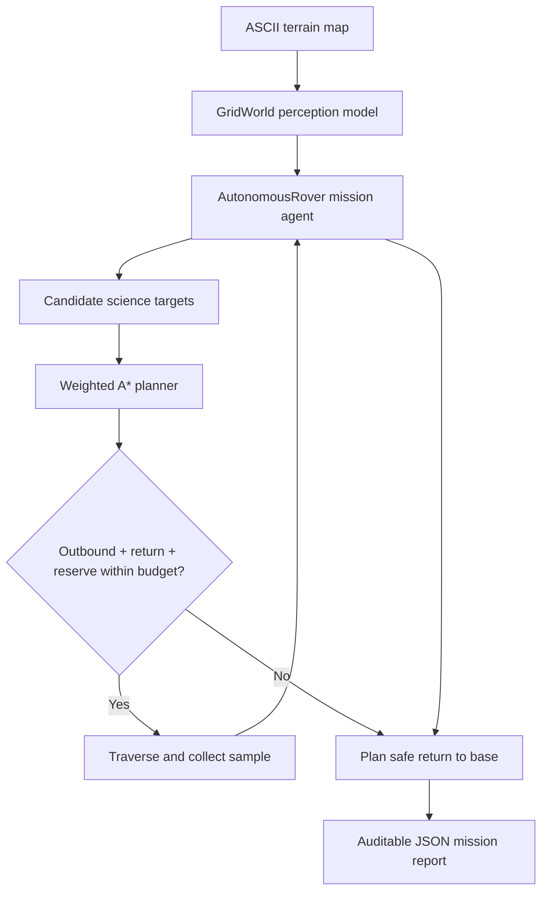

# Ares Rover

**A deterministic autonomy benchmark for energy-aware planetary mission planning.**

[](https://github.com/haarikaalla/Agentic-AI-Mars-Rover/actions/workflows/ci.yml)


Ares Rover models a goal-driven Mars rover that must collect science samples and return safely to base without violating its energy reserve. The repository combines a reusable Python autonomy package, weighted A* path planning, an auditable command-line simulator, deterministic mission maps, strict quality checks, and automated tests.

This project focuses on a central robotics problem: a path is not useful merely because it reaches a target. It must account for terrain cost, remaining energy, unreachable locations, mission priorities, and the ability to return safely.

## Mission impact

Planetary rovers operate with limited power, delayed communication, and no immediate human rescue. An autonomous planner must make conservative decisions that can be explained after the mission.

Ares demonstrates these principles by:

- selecting reachable science targets using route and return cost;
- finding lowest-energy paths across variable terrain;
- reserving enough energy for a safe return to base;
- stopping science collection before safety is compromised;
- reporting the full route, energy use, steps, samples, and outcome;
- producing repeatable simulations suitable for tests and algorithm comparisons.

## Core capabilities

| Capability | Implementation | Engineering value |
| --- | --- | --- |
| Terrain-aware planning | Weighted A* with Manhattan heuristic | Minimizes energy rather than only distance |
| Mission autonomy | Goal selection and sequential replanning | Adapts the route after each collected sample |
| Safety reserve | Outbound + return + reserve calculation | Prevents targets from stranding the rover |
| Failure handling | Explicit unreachable-path reports | Produces safe, diagnosable outcomes |
| Deterministic world | Human-readable ASCII maps | Makes experiments reproducible and reviewable |
| Audit trail | Structured JSON mission report | Explains every simulated mission result |
| Quality gates | pytest, Ruff, mypy, GitHub Actions | Protects behavior and code quality |

## Autonomy architecture



### Decision cycle

1. Parse and validate the terrain map.
2. Locate the rover, base, and all science targets.
3. Calculate an energy-aware route to every remaining target.
4. Calculate the safe return route from each candidate.
5. Select the lowest combined-cost feasible target.
6. Execute the route and update remaining energy.
7. Replan until all samples are collected or the safety threshold is reached.
8. Return to base and emit the mission report.

## Technology stack

- **Python 3.11+** — typed autonomy and simulation core
- **Dataclasses** — explicit immutable positions and structured mission results
- **Weighted A\*** — cost-aware graph search with an admissible heuristic
- **Hatchling** — modern Python package build backend
- **pytest** — deterministic mission and safety tests
- **Ruff** — fast linting and style enforcement
- **mypy** — static type verification
- **GitHub Actions** — clean-environment CI on every push and pull request

The runtime deliberately uses only the Python standard library. Development tooling is isolated in the optional `dev` dependency group.

## Terrain model

Mission maps are rectangular text grids:

| Symbol | Meaning | Energy cost |
| --- | --- | --- |
| `R` | Rover starting position | 1 |
| `B` | Return base | 1 |
| `S` | Science target | 1 |
| `.` | Normal traversable terrain | 1 |
| `1`–`9` | Traversable terrain | Numeric symbol value |
| `#` | Impassable hazard | Not traversable |

Example:

```text
R..2..S
.##2...
...3.#.
S..1..B
```

The planner may choose a longer geometric route when it consumes less energy, which is essential for meaningful mission simulation.

## Quick start

### Prerequisites

- Python 3.11+
- Git

### Install

```bash
git clone https://github.com/haarikaalla/Agentic-AI-Mars-Rover.git
cd Agentic-AI-Mars-Rover

python -m venv .venv
source .venv/bin/activate            # Windows: .venv\Scripts\activate
python -m pip install --upgrade pip
pip install -e '.[dev]'
```

### Run a mission

```bash
ares-rover examples/mission.map --energy 40 --reserve 5
```

The simulator prints a machine-readable report:

```json
{
  "success": true,
  "reason": "all science targets collected and rover returned to base",
  "energy_used": 18,
  "steps": 18,
  "samples_collected": 2,
  "route": [[0, 0], [0, 1], [0, 2]]
}
```

Actual values depend on the selected map and energy settings.

## Python usage

```python
from rover.agent import AutonomousRover
from rover.world import GridWorld

world = GridWorld.from_text("""
R..S
.#..
...B
""")

report = AutonomousRover(world, energy_budget=30, reserve=5).run()
print(report.success, report.energy_used, report.route)
```

## Verification

```bash
ruff check src tests
mypy src/rover
pytest
```

The suite exercises successful missions, weighted terrain choices, low-energy aborts, unreachable goals, map validation, and safe-return behavior. CI runs the same quality gates in a fresh Python 3.12 environment.

## Project structure

```text
.
├── .github/workflows/ci.yml   # lint, types, and tests
├── examples/mission.map       # ready-to-run mission scenario
├── src/rover/
│   ├── agent.py               # mission policy and safety logic
│   ├── cli.py                 # command-line interface and JSON output
│   ├── planner.py             # weighted A* implementation
│   └── world.py               # terrain and position model
├── tests/test_mission.py      # autonomy regression suite
├── pyproject.toml             # packaging and tool configuration
└── LICENSE
```

The original research notebook and public Mars datasets remain available as exploration inputs, while the tested `src/rover` package is the maintained autonomy core.

## Engineering decisions

- **Determinism first:** identical maps and budgets produce identical results, enabling trustworthy regression tests.
- **Energy as path cost:** route quality reflects mission constraints rather than visual distance alone.
- **Explicit reserve:** safety is a visible policy parameter, not an accidental side effect.
- **Explainable decisions:** the full route and reason are returned for every mission.
- **Dependency-light runtime:** the core remains portable to constrained or educational environments.

## Current scope and roadmap

This is a high-quality planning and simulation benchmark, not flight-certified rover software. Strong next steps include:

- dynamic obstacle discovery and online replanning;
- multiple resource constraints such as time, thermal state, and storage;
- probabilistic terrain and sensor uncertainty;
- multi-objective target value and risk scoring;
- ROS 2 and Gazebo adapters;
- learned perception feeding the deterministic safety planner;
- mission replay visualization and performance benchmarks.

## License

This project is available under the [MIT License](LICENSE).
